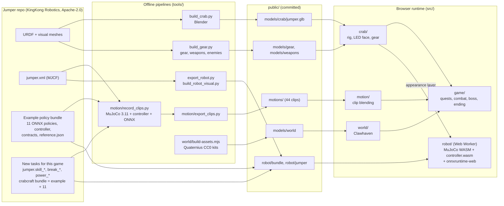

<p align="center">
  
</p>

<h1 align="center">World of Crabcraft</h1>

<p align="center">
  <b>A fantasy RPG in the browser where every character is a Jumper crab robot,<br>
  and every walk, wave, dance and breakdance move comes from the robot's own trained policies.</b>
</p>

<p align="center">
  Crab Robot Open-source Challenge 2026 (BE UNLIMITED) entry |
  <a href="LICENSE">Apache-2.0</a> |
  <a href="README.zh.md">简体中文</a> |
  <a href="docs/SUBMISSION.md">Contest entry text</a>
</p>

Six races, three classes, one harbour town, a four-quest chain, a three-phase boss and a town-wide
dance party at the end, where your crab breaks: toprock, six-step, spin, a 720, a back flip and a
one-claw freeze. Every crab, from the player to the boss, is the
[Jumper](https://github.com/KingKongRobotics/jumper) robot by KingKong Robotics wearing different
paint and gear. Then open **Robot Mode** and the crab you made runs on Jumper's real controller and
policies, live, in MuJoCo, in the same tab.

*Six shells. One tide.*

## What makes it different

**The motion is the robot's, not an animator's.** All 44 of the game's motion clips are closed-loop
rollouts of trained Jumper policies in MuJoCo 3.11, every one driven through a bundle's own
controller extension. 31 come from the Jumper example bundle: walking in 8 directions, turning, the fast gait, the jump,
both claw modes, 4 gestures and 4 dances, with `dance_crab` at its full 238.6 s. The 6 combat moves
the robot had no policy for (`attack_swipe`, `attack_slam`, `cast`, `hit_react`, `death`, `sit`)
come from **six new Jumper tasks, published with this project in [`jumper/`](jumper/)**: `jumper.skill_swipe`, `skill_slam`,
`skill_cast`, `skill_flinch`, `skill_powerdown` and `skill_sit`, reference clips authored on the
robot's own model and trained with motion-imitation reinforcement learning (2,000 to 3,000 PPO iterations each on one
H100). Started from the standing pose in the task's own environment, the six policies did not fall
in 84 rollouts (10 per move with the training's domain randomisation, 4 without), and track their
reference within 0.26 to 1.54 degrees joint RMS over the move, where standing still would be 11 to
39 degrees off. Death is now the power-down policy: the legs give way and the shell settles on the
ground, where the corpse stays.

**A breakdance, every move a trained policy.** Press <kbd>B</kbd> and your crab breaks; at the ending
it is the finale while the town cheers. Seven more new Jumper tasks, in [`jumper/`](jumper/) too:
four tracked moves, `jumper.break_toprock` (an 8-count at 107 bpm), `break_sixstep` (footwork
round the claws), `break_clawstand` and `break_oneclaw` (freezes held nose-down on the claws), and
three reward-driven power moves, `jumper.power_spin_feet` (2.3 turns a second on its feet),
`power_jumpspin720` (679 degrees in the air on average, 32 of 32 landings upright with domain
randomisation, trained with its joint targets clamped at the stops) and `power_backflip` (a whole
back flip, 32 of 32 landing on its feet and coming to rest level near the standing pose), both
jumping from the pose the controller hands a new mode and standing still once they have landed. The routine plays six of them in a row (the claw stand is in Robot Mode) at the policies' own pace and carries each move's travel and turn over
to the crab, so the six-step that comes out 2 degrees short of a full turn and the 720, which has
turned 751 degrees by its landing, leave the crab facing where the policy left the robot. These are
simulation results: none of the seven has run on a physical Jumper. The six-step closes its turn,
357.7 of 360 degrees, because its policy sees how far its heading has fallen behind the recording's,
a term the controller builds from the IMU's yaw since the move began; whether a physical Jumper's
AHRS yaw follows its gyro, which that needs, has not been checked. The back flip turns upside down in
the air (177 degrees of tilt), so its mode lifts the controller's 50-degree tilt fallback for that
mode only; on a physical robot nothing would catch a fall while the flip runs, so it would need
care (a soft floor, a hand on the release).

**Robot Mode runs the real stack in your browser.** The official MuJoCo 3.11.0 WebAssembly build
(`@mujoco/mujoco`), onnxruntime-web 1.30.0 and the bundle's own `controller.wasm` load 24 ONNX
policies (25 modes): the example bundle's 11, the six skills and all seven breakdance moves, built
into one bundle by Jumper's own `scripts/deploy.py`, at the robot's control rate (199 Hz measured
while walking). Keys 5 6 7 8 9 0 swipe, slam, cast, flinch, power down and sit, live, and hand back
to walking; <kbd>Shift</kbd> + 1 2 3 4 toprock, six-step, claw stand and one-claw freeze the same
way, and <kbd>Shift</kbd> + 5 spins until pressed again (2.3 turns a second on the browser's
physics). <kbd>Shift</kbd> + 6 is the 720 and <kbd>Shift</kbd> + 7 the back flip: on the browser's
physics, 12 times each from standing and from walking, the 720 turns 682 to 750 degrees in the air
and the flip 375 to 383 degrees nose-up, and both land and come to rest, the 720 about 10 degrees
nose-up on its rear legs and the flip within a degree of level near its standing pose. Neither has
an end of its own, so the page presses its switch again once it is at rest (1.4 s and 1.2 s after
the controller hands over, at least 0.26 s after the latest rest), and says so in the log; the
hand-back brings the 720 level. The spin sends its joint targets up to 1.7 rad past the joint
stops, as it trained; the 720, trained again with its targets clamped at the stops, sends none past
them (see Known limits). Before
the robot wakes, the page proves it agrees with the bundle: it replays `reference.json` through
the controller (24 frames, observation diff 0, target diff 0), compares the policy outputs
with the recorded actions (max diff 8.3e-7) and checks 71 bundle files against their SHA-256.

**The whole breakdance, live, on the beat.** Press <kbd>P</kbd> in Robot Mode (or Routine in the
dock) and the robot performs the routine as one set: toprock, six-step, spin, 720, back flip and the
one-claw freeze, each move its own policy running live under the bundle's controller, to an original
beat at the toprock's 107.14 bpm. Nothing is recorded or spliced in. The page presses the bundle's
own switches (<kbd>Shift</kbd> + 1, 2, 5, 6, 7, 4), says every press in the log, and times them in
simulated time so that each policy starts on the downbeat of its bar: a press has to come early by
the controller's ramp to the move's home pose (0.59 to 0.83 s), which the page predicts from how far
the joints are from that pose. Every move hands the robot back to walking before the next press, the
spin is ended by its own switch on a beat, the 720 and the back flip by the page's press after the
landing, and the freeze lands on the downbeat of the final stab. In 10 headless runs from standing,
walking, turning, strafing and just after a move, all 10 completed without a Safe Hold and ended
walking upright, the power moves started within 15 ms of their downbeats and the tracked moves within
60 ms. Any robot control, the gamepad or <kbd>P</kbd> again stops it and hands the robot back to
walking. The music is the breakdance video's synthesised beat arranged on the routine's 17 bars, and
the page keeps it in step with the simulation (within 30 ms in Chrome). This is the simulation again:
the routine has not run on a physical Jumper.

**Same policy, any appearance.** Press <kbd>T</kbd> in Robot Mode to switch between the bare robot and
the crab you created, gear, weapon and LED face included, posed every frame from the same live
simulation. The crab's skeleton is Jumper's URDF, so its links sit on the physics bodies (within 0.0013 mm).

<p align="center">
  
  <br><sub>Robot Mode, live: one <code>dance_crab</code> policy run, drawn as the player's crab, then as the bare robot, then as the crab again.</sub>
</p>

## Feature tour

### Title


Painted key art and logo made for this project. Enter World, Robot Mode and Credits; Continue appears
once you have saved a crab.

### Character creation


The genre's classic layout with our own art: race portraits and class emblems on the left, your crab
on a carved dais, lore on the parchment. Pick one of 6 races, 2 sexes (visor eye shape) and 3 classes,
then 4 shell paints, 4 crest styles and 3 LED colours per race, a name or Randomize. Drag to rotate.


One robot body, six peoples. Race comes from paint, posture, LED behaviour and gear modelled against
the real shell: a plumed helm and tabard, tusk guards and a horned skull cap, a braided cable beard,
a cracked shell with exposed servos, long swept antennae, great horns with totem beads. The class
puts a sword and shield, a sea-glass staff or a lantern and hymn book in the claws.

### Clawhaven


The starting zone: Clawhaven Square with its pincer fountain, Barnacle Forge, the Chapel of the Tide,
the Molting Kettle tavern, Moonpool Grove, the Brine Shore, Saltmere Lighthouse and the Iron Wreck.
Seven named NPCs, covering all six races, hand out quests, hints and flavour, gesture and talk;
townsfolk stroll the streets on the recorded walking clips. Buildings, props and nature come from Quaternius CC0 kits.

### Combat


Three classes with four abilities each: the Warrior builds Rage and spends it on Shell Bash, Sideways
Charge and Whirlpool; the Mage casts Bubble Bolt, Frost Spray, Steam Blink and Tidal Nova; the Priest
uses Smite, Mend Shell, Barnacle Ward and Holy Tide. Cast bars, cooldowns, a 1 s global cooldown,
target frames, nameplates, a quest tracker and a minimap. Enemies are Scraplings and Rustclaw
Scavengers, rusted crab drones from the wreck.

### Corrodius, the Rust Tyrant


The quest chain "The Rust Tide" (Salt in the Gears, Moonwater, Light the Beacon, The Rust Tide) ends
on the deck of the Iron Wreck. Corrodius fights in 3 phases: telegraphed Anchor Slam and a Rust Spray
cone, then Scrapling adds and Undertow, then an enrage. When he falls, a small red crab steps out of
the armour.

### The ending


Back in the square the whole town gathers in a ring around you and dances the recorded dance policies
(`dance_crab`, `dance_brazilian`, `dance_dream_wings`, `dance_maze`) under fireworks. Then the ring
makes room and your crab performs the breakdance routine, each move captioned: the crowd waves along
with the toprock, shouts at the spin, hops and raises its claws when the 720 and the back flip land,
and erupts with fireworks at the freeze. Everyone dances again, then the credits roll.

### Robot Mode


A sunny tabletop in the style of the Jumper TVC. Drive the robot with the keyboard, the on-screen dock
or a gamepad, all through the bundle's own bindings. The HUD shows the live mode and control rate,
inference and physics timings, all 22 joints (angle, target, torque) and the start-up checks. Top: an
Orc Warrior crab walking on the locomotion policy. Bottom: one `dance_crab` run, drawn as that crab
and, after <kbd>T</kbd>, as the bare robot.

## Controls

**In the game**

| Input | Action |
|---|---|
| <kbd>W</kbd> <kbd>S</kbd> or <kbd>Up</kbd> <kbd>Down</kbd> | Walk forward, back |
| <kbd>A</kbd> <kbd>D</kbd> | Walk sideways (crabs strafe) |
| <kbd>Q</kbd> <kbd>E</kbd> or <kbd>Left</kbd> <kbd>Right</kbd> | Turn |
| Left drag, right drag, wheel | Orbit the camera, orbit and steer, zoom |
| Both mouse buttons | Walk forward |
| <kbd>Space</kbd> | Jump |
| <kbd>B</kbd> | Breakdance: the six-move routine from standing; moving, turning, jumping, an ability or a hit ends it |
| <kbd>Tab</kbd>, click | Target the nearest enemy in front; target what you click (a nearby NPC also starts talking) |
| <kbd>1</kbd> to <kbd>4</kbd> | Abilities |
| <kbd>F</kbd> | Talk, interact, take the main dialogue choice; hold to relight the beacon |
| <kbd>L</kbd> | Quest log |
| <kbd>M</kbd> | Music on or off |
| <kbd>Enter</kbd> | Chat bubbles on or off |
| <kbd>Esc</kbd> | Cancel a cast, clear the target, open the menu (graphics quality Low or High) |
| <kbd>R</kbd> twice | Open Robot Mode (resets quest progress) |

**In Robot Mode** (the bundle's own bindings from its `controller.toml` and manual; <kbd>Q</kbd>
<kbd>E</kbd>, <kbd>T</kbd>, <kbd>C</kbd>, <kbd>P</kbd> and <kbd>R</kbd> are added by the page)

| Input | Action |
|---|---|
| <kbd>W</kbd> <kbd>A</kbd> <kbd>S</kbd> <kbd>D</kbd> or arrows | Walk and step sideways |
| <kbd>Q</kbd> <kbd>E</kbd> (or <kbd>J</kbd> <kbd>L</kbd>) | Turn |
| <kbd>N</kbd> <kbd>M</kbd> | Stand taller, crouch lower |
| <kbd>Space</kbd> | Jump |
| <kbd>1</kbd> to <kbd>4</kbd> | Gestures: hello, bow, paw, salute |
| <kbd>Ctrl</kbd> + <kbd>1</kbd> to <kbd>4</kbd> | Dances: crab, Brazilian, maze, dream wings |
| <kbd>5</kbd> to <kbd>0</kbd> | Skills: swipe, slam, cast, flinch, power down, sit |
| <kbd>Shift</kbd> + <kbd>1</kbd> to <kbd>4</kbd> | Breaking: toprock, six-step, claw stand, one-claw freeze |
| <kbd>Shift</kbd> + <kbd>5</kbd> | Spin; press again to stop |
| <kbd>Shift</kbd> + <kbd>6</kbd> <kbd>7</kbd> | 720 jump spin, back flip; back to walking by themselves after the landing |
| <kbd>P</kbd> | The whole breakdance routine, live on the beat, with its music; <kbd>P</kbd> again or any robot control stops it |
| <kbd>V</kbd> <kbd>B</kbd> | Left or right claw mode |
| <kbd>Ctrl</kbd> | End a gesture, dance, skill or breaking move early |
| <kbd>Esc</kbd> | Let go of every control |
| <kbd>T</kbd> | Bare robot or your crab |
| <kbd>C</kbd>, <kbd>R</kbd> | Follow camera on or off, reset the robot |
| Drag, wheel | Orbit, zoom |
| Gamepad | The robot's own pad bindings (sticks walk and turn, A jumps, D-pad gestures, menu + D-pad dances, LB and RB claws, menu + A X Y LB RB L3 skills, home + A X Y L3 LB breaking moves) |

## Run it

You need Node.js and pnpm (tested with Node 26.7, which also runs the `.ts` tools directly, and
pnpm 11.22) and a desktop browser with WebGL2 and WebAssembly (tested in Chrome on an Apple M4 Pro
Mac).

```bash
pnpm install
pnpm dev        # http://localhost:5173
pnpm build      # type-check, then a static site in dist/
pnpm preview    # serve dist/ locally
```

Every built asset is committed under `public/`, so no offline pipeline has to run to play.
The build uses a relative base (`base: './'`), so `dist/` can be served from any path. Robot Mode
runs onnxruntime-web on one thread and does not need cross-origin isolation: the built site,
Robot Mode included, also runs from a plain `python3 -m http.server` without COOP or COEP headers
(the dev server sends them anyway).

URL parameters:

| URL | Opens |
|---|---|
| `/` | Title screen |
| `/?screen=create` | Character creation |
| `/?screen=game` | Clawhaven with your saved crab (a default Human Warrior if none is saved) |
| `/?screen=robot` | Robot Mode (wears your saved crab, or offers a race and class picker) |
| `/?screen=credits` | Credits |
| `&debug=1` (with `screen=game`) | Debug keys: <kbd>F8</kbd> god mode, <kbd>F9</kbd> complete the current objective, <kbd>F10</kbd> teleport to the next objective, plus an fps readout |

Your crab is saved in `localStorage` under `cc.spec`.

## How it works



- **Crab model.** `tools/build_crab.py` builds `public/models/crab/jumper.glb` from Jumper's URDF and
  visual meshes in headless Blender: one node per link with the joint axis and limits, rotating a
  link about its axis by `q` gives MuJoCo `qpos = q`. `src/crab/` skins it (about six draw calls per
  crab), adds the signed-distance LED face (11 expressions: neutral, happy, angry, hurt, dead, love,
  sleepy, surprised, focused, blink, talk) and dresses it with gear from `tools/build_gear.py`:
  6 races x 4 crests, 3 class weapons, NPC extras and 3 enemies (Scrapling, Rustclaw Scavenger,
  Corrodius).
- **Motion.** `tools/motion/jumper_sim.py` is a headless host for a bundle: MuJoCo, onnxruntime and
  the bundle's own controller extension, with the contact, solver and servo settings taken from the
  upstream training configuration. `record_clips.py` drives it the way `play --app` does (velocity
  commands for walking, the bundle's own pad bindings for jump, gestures, dances, claws and, through
  the crabcraft bundle, the six skills). `export_clips.py` cuts seamless loops and quantises them into
  `public/motions/`; for the skills it also moves each reference moment (the swipe's hit, the slam's
  impact, read off the claw pads' contact, the cast's release, the shell settling) to where the policy
  played it and writes the game's windows to `src/motion/skillClips.ts`. In the game, `src/motion/`
  blends the clips (phase-synchronised walking underneath, actions layered on top) and
  `src/motion/skills.ts` plays each skill's move, not its whole rollout, with gameplay timed by the
  clip's own moments. The breakdance's seven moves are recorded the same way, on the crabcraft bundle's
  Home chords; the spin and the two jumps, which have no end of their own, are let go with the same
  chord after a fixed time.
  `src/motion/breakdance.ts` plays the routine from the windows in `src/motion/breakClips.ts` and
  hands each move's travel and turn over to the crab as it fades out
  (`MotionPlayOptions.carryRoot`): where one move hands over to the next, the body's heading changes
  by under 1 degree while the crab's root turns up to 112. Gameplay crabs play recorded rollouts;
  physics runs live only in Robot Mode.
- **Robot Mode.** `tools/export_robot.py` exports Jumper's physics model with the training contact
  and solver settings; `tools/build_robot_visual.py` decimates the visual meshes. In the browser a Web
  Worker (`src/robot/sim/`) loads the bundle the way its README asks a host to, builds MuJoCo, the
  controller and one onnxruntime-web session per policy, and steps
  `set_state, operator input, tick, infer, positions/kp/kd` every 5 ms with the robot's servo law
  (PD torque clipped to the measured torque-speed curve and thermal budget). The page renders about
  120 pose frames a second on the TVC-style desk and hands your keys and gamepad to the controller.
  The live routine (`src/robot/sim/routine.ts`) runs inside that same control tick, in simulated
  time: it presses the bundle's switches through the path the keyboard takes, and the page's music
  (`public/audio/music-breaking.*`, arranged by `tools/robot-routine-music.mjs`) follows the
  simulation's clock rather than the other way round.
- **World and game.** `src/world/` builds Clawhaven and the Brine Shore from code plus the Quaternius
  kits; `src/game/` runs quests, combat, AI, the boss, effects, music and the HUD.

## How it was verified

| Check | Command | Result |
|---|---|---|
| Motion host agrees with the bundle | `tools/motion/check_bundle.py [--bundle <crabcraft bundle>]` | Controller replay of `reference.json`: observation diff 0; target diff 0 (example bundle and crabcraft bundle). ONNX vs recorded actions: max diff 9.5e-07 (example bundle), 0 (crabcraft bundle) |
| The six skill policies track their moves | evaluation in each task's own environment, from the standing pose | 0 falls in 84 rollouts; joint RMS over the move 0.26 to 1.54 deg without domain randomisation, 0.42 to 1.68 deg with it (standing still: 11.2 to 39.4 deg) |
| Crab model is kinematically Jumper | `tools/check_crab_fk.py` | 41 bodies x 13 poses vs MuJoCo: max position error 0.000534 mm |
| The breakdance policies | evaluation in each task's own environment, from the standing pose | tracked moves: 0 falls in 70 rollouts, joint RMS over the move 0.65 to 2.68 deg with domain randomisation (standing still: 10.1 to 32.8 deg); the six-step turns 357.7 of 360 deg (355.5 to 359.4 with randomisation). Power moves, 32 rollouts each with randomisation, the jumps from the controller's handover: spin 2.32 turns/s; 720 jump spin 679 deg in the air, 32 of 32 upright, its targets clamped at the stops; back flip 384 deg in the air, 32 of 32 upright; from 0.5 s after the landing their joints move at 0.04 and 0.03 rad/s RMS (`tools/eval_calm.py`, 16 rollouts) |
| Robot Mode simulation, headless | `node tools/robot-sim-check.ts` | 21.65 m in 30 s of walking without a fall, max tilt 1.88 deg, jump apex 0.228 m; each of the six skills and the five breaking modes entered on its key, played out (the spin held 4 s at 2.36 turns/s, then let go; the six-step turning 357.7 deg under its policy, the check asks for 350) and handed back to walking (max tilt 35.0 deg, the one-claw freeze); the 720 and the back flip, each from standing and from walking, take off, land upright (never in `safe`; tilt 0.3 s after touchdown 10.2 and 10.1 deg for the 720, the pose it rests in, 2.9 and 2.1 for the flip) and are handed back by the page's own press: 720 680 and 686 deg in the air at 0.33 m of rise, flip 384 and 374 deg nose-up (the check asks for 660 and 330 at least); the live routine, 5 runs (10 with `--routine 10`) from standing, walking, turning, strafing and after a move: every run completes, every move entered and handed back, no Safe Hold, ending walking upright, policies starting within 15 ms (power moves) and 60 ms (tracked moves) of their downbeats |
| Robot Mode start-up checks, in the page | open `/?screen=robot` | `reference.json` replay 24 frames, observation diff 0, target diff 0; policy outputs vs recorded actions 8.3e-7; 71 bundle files match their SHA-256 |
| The breakdance, in the page | `node tools/breakdance-check.mjs` (dev server running) | <kbd>B</kbd> plays all six moves in order and ends completed, walking ends it early; in Robot Mode each of the seven breaking modes runs live and hands back to walking, the two jumps by the page's own press and never through the Safe Hold; <kbd>P</kbd> plays the live routine to the end on its downbeats with the page's presses logged and the music within 30 ms of the simulation, and <kbd>P</kbd> again stops it back to walking; 0 console errors |
| Crab drawn on the live simulation | `node tools/robot-skin-shots.mjs <app url> <out dir>` | All 41 crab links within 0.0013 mm of the physics bodies while standing, walking and dancing |
| Whole game, end to end | `pnpm dev --port 5206` in one terminal, `node tools/playtest.mjs` in another | Warrior, Mage and Priest each play every quest, the boss and the ending with 0 console errors |

The Python tools need a Jumper checkout (`JUMPER_ROOT`, with the example bundle built at
`out/bundle_example/jumper`; the skills and the breakdance need the tasks applied from [`jumper/`](jumper/) and the
crabcraft bundle, `python scripts/deploy.py --manifests deploy/crabcraft.manifests.json
--allow-incomplete`) and an
interpreter with `mujoco` and `onnxruntime`; the Blender scripts need Blender. See the docstring at
the top of each script.

## Project layout

```
src/
  app.ts, main.ts   screen switching (title, create, game, robot, ending, credits)
  core/             renderer and post-processing, input, audio, asset loading, follow camera
  crab/             Jumper rig from jumper.glb, LED face, race posture, gear
  data/             races and classes
  motion/           clip library and the blending motion controller
  world/            Clawhaven, the shore, lighthouse, wreck, water, sky, foliage
  game/             quests, combat, abilities, enemies, boss, NPCs, ending, VFX
  robot/            Robot Mode: HUD, worker client, sim/ (MuJoCo + controller + ONNX), view/
  screens/          title, character creation, game, Robot Mode
  ui/               HUD widgets, fonts, theme
public/             built assets: art, audio, fonts, models, motions, robot bundle
tools/              asset pipelines, motion recording, checks, playtest and screenshot scripts
dev/                standalone harness pages (crab turntable, motion viewer, world, robot)
docs/               design document, contest entry text, README media
requirements/       the original requirements
```

## Known limits

- One zone, single player, desktop keyboard and mouse. Gamepad input exists only in Robot Mode.
- In the game the crabs replay recorded policy rollouts; they are not simulated. Robot Mode is the
  part that runs physics and policies live.
- The breakdance is simulation only. Seven of its policies were trained for this game and none has
  run on a physical Jumper. The back flip's mode lifts the controller's 50-degree tilt fallback while
  it runs; on a robot, a flip that went wrong would not be caught by it.
- The 720 and the back flip have no end of their own. Robot Mode presses their switch again at a
  fixed time after the handover (1.4 s, 1.2 s), 0.28 s and 0.275 s after the latest either came to
  rest through the bundle's controller, rather than detecting the landing.
- The spin lets its joint targets go up to 1.7 rad past the joint stops (`target_margin` on its
  mode; every other mode is clamped at the stops), as its training did: clamped, it spins 0.3 turns
  a second slower. On a robot a joint at its stop would be held against it at up to 1.746 N m for as
  long as its target points past it, and the target sent can reach about 6.45 rad. That has not been
  tried on a physical Jumper.
- The 720 needed the same margin until it was trained again with its targets clamped at the stops.
  It now sends every target within them, and that cost it something: it rises 0.35 m rather than
  0.39, rests about 10 degrees nose-up after landing, and with the training's randomisation one
  landing in 32 tilted 49.1 degrees, close to the controller's 50-degree fallback.
- The six-step's turn closes on the IMU's yaw, counted from the moment the move begins. Whether a
  physical Jumper's AHRS yaw follows its gyro has not been checked; if it held still, the policy
  would see its turn falling behind and push to catch up.
- The live routine's presses are timed from a model of the controller's ramp fitted on this
  simulation (`src/robot/sim/routine.ts`); the tracked moves' ramps vary in ways the model does not
  explain, so they start up to about 60 ms off the downbeat. The routine moves the robot up to about
  0.4 m and the desk has toys and books on it: started next to them, a move can land on one. It
  waits a bar (and logs it) when the robot is not walking when a move is due, and stops if that goes
  on for four bars.
- The bundle has no get-up policy. If the robot tips over in Robot Mode it holds in `safe`, and the
  page stands it back up after 3 s.
- The bundle marks its web controller as not verified by the consumer; Robot Mode shows that notice
  next to its own start-up checks.
- Frame rate: the playtest reported 60 fps in town, combat, the boss fight and the ending on an
  Apple M4 Pro Mac in Chrome. Other hardware has not been measured; the Esc menu has a Low quality
  setting.
- The music and sound effects were not checked by listening; they are built by script from CC0
  sources, and the live routine's beat is synthesised by `tools/trailer/breakdance/beat.py`.

## Credits

- **Jumper** robot model, meshes, policies and bundle runtime: KingKong Robotics,
  [github.com/KingKongRobotics/jumper](https://github.com/KingKongRobotics/jumper), Apache-2.0.
- **MuJoCo** WASM bindings (Google DeepMind, Apache-2.0), **onnxruntime-web** (Microsoft, MIT),
  **three.js** and **postprocessing** for rendering.
- **World kits**: Quaternius Medieval Village, Stylized Nature and Fantasy Props MegaKits (CC0).
- **2D art** (paintings, portraits, icons, UI, logo) generated for this project with OpenAI GPT image
  generation, with Google Gemini 3 Pro Image for the upscaling pass; prompts are in `tools/art/`.
- **Music and sound**: CC0 tracks and effects from OpenGameArt and Kenney, plus procedural layers.
- **Fonts**: Cinzel, Cinzel Decorative and Alegreya (OFL-1.1).

Every third-party file, with its source URL, author and license, is listed in [NOTICE.md](NOTICE.md).
Game design and lore: [docs/design.md](docs/design.md).

## License

World of Crabcraft is released under the [Apache License 2.0](LICENSE). Jumper materials are
Copyright 2026 KingKong Robotics under the same license. The art, models, lore and UI were made for
this project or come from the sources in [NOTICE.md](NOTICE.md); only the classic layout of the
genre's character creation screen is borrowed.
