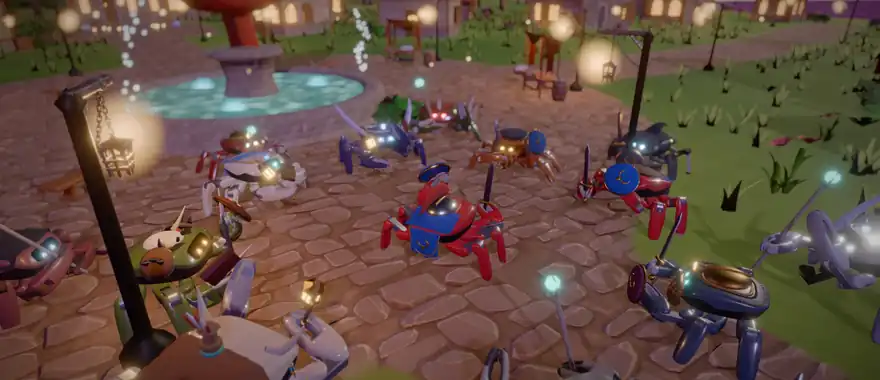
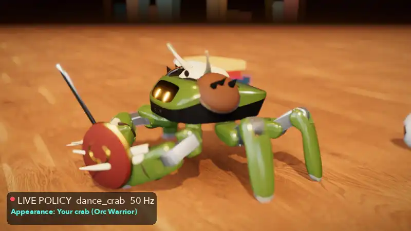
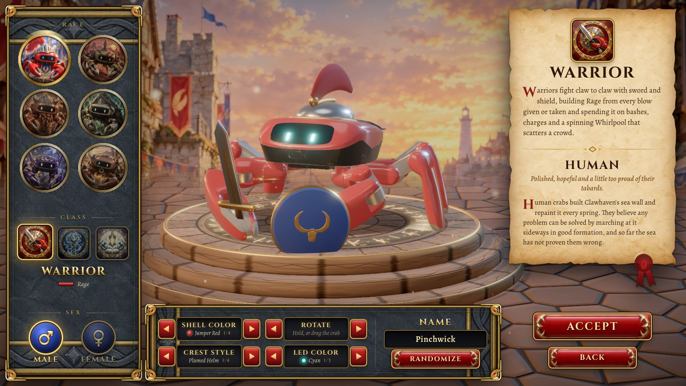
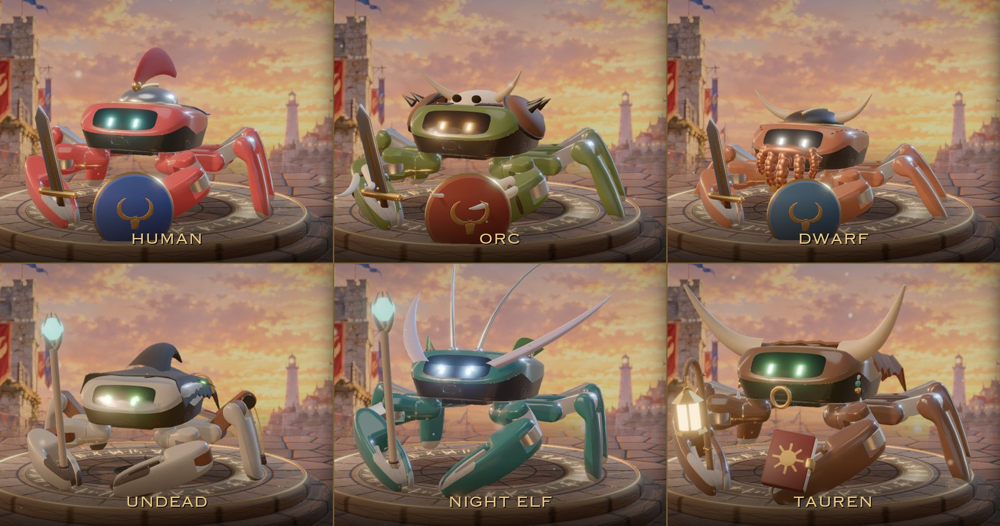
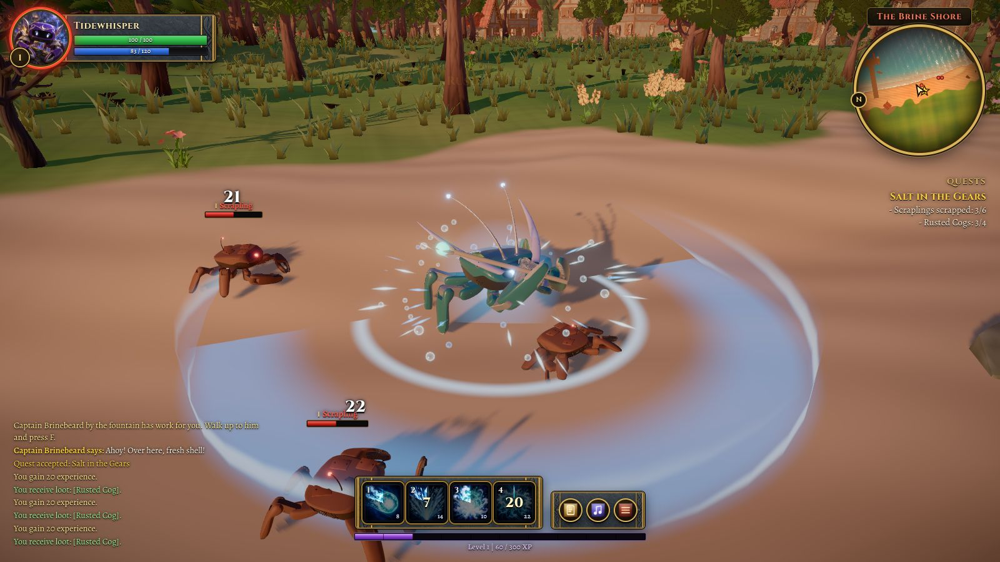
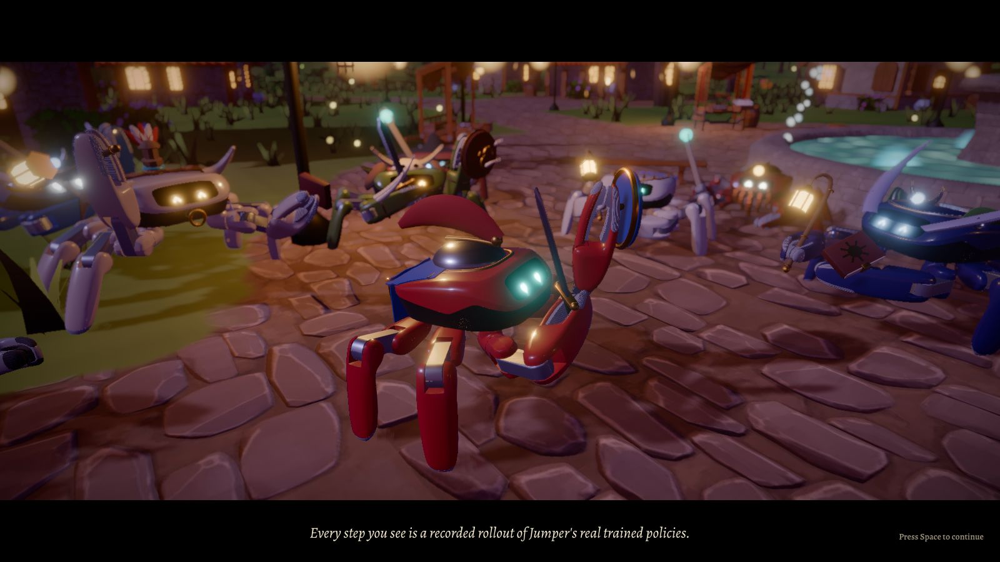
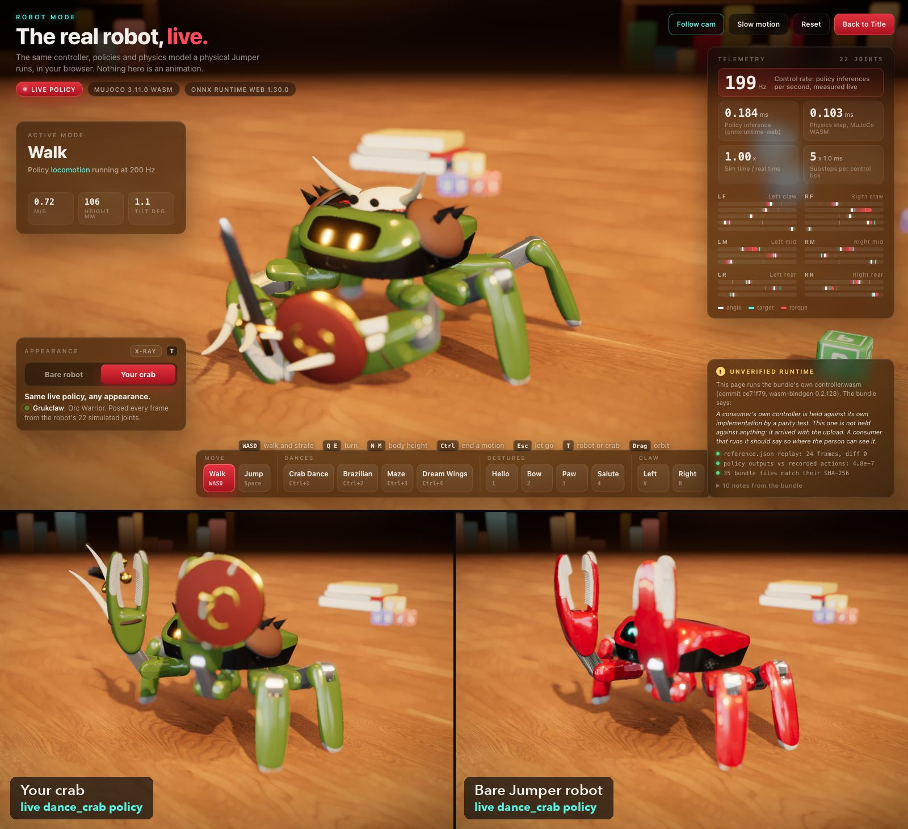

<p align="center">
  
</p>

<h1 align="center">World of Crabcraft</h1>

<p align="center">
  <b>一款在浏览器里运行的奇幻 RPG：每个角色都是 Jumper 螃蟹机器人，<br>
  每一次行走、挥手、舞蹈和霹雳舞动作都来自机器人自己训练出的策略。</b>
</p>

<p align="center">
  螃蟹机器人开源动作大赛 2026（BE UNLIMITED）参赛作品 |
  <a href="LICENSE">Apache-2.0</a> |
  <a href="README.md">English</a> |
  <a href="docs/SUBMISSION.md">参赛介绍</a>
</p>

六个种族、三个职业、一座港口小镇、由四个任务组成的主线、一个三阶段 Boss，最后全镇一起跳舞，你的螃蟹还会跳一段霹雳舞：toprock、six-step、原地旋转、720 度跳转、后空翻和单钳定格。玩家、NPC 和 Boss 全都是 KingKong Robotics 的 [Jumper](https://github.com/KingKongRobotics/jumper) 机器人，只是涂装和装备不同。打开 **Robot Mode（机器人模式）**，你创建的螃蟹就会在同一个标签页里，用 Jumper 真实的控制器和策略在 MuJoCo 中实时运行。

## 真实策略，而不是手工动画

- 游戏里全部 44 段动作，都是训练好的 Jumper 策略在 MuJoCo 3.11 中闭环运行后录制下来的，其中 42 段通过 bundle 自带的控制器扩展运行。31 段来自 Jumper 示例 bundle：8 个方向的行走、转身、快速步态、跳跃、左右钳子模式、4 个手势和 4 支舞蹈，`dance_crab` 保留了完整的 238.6 秒。
- 机器人原本没有策略的 6 段战斗动作（`attack_swipe`、`attack_slam`、`cast`、`hit_react`、`death`、`sit`），来自随本项目一同发布在 `jumper/` 目录中的 **6 个新 Jumper 任务**：`jumper.skill_swipe`、`skill_slam`、`skill_cast`、`skill_flinch`、`skill_powerdown`、`skill_sit`。参考动作在机器人自己的模型上制作，再用动作模仿强化学习训练成策略（每个在一张 H100 上训练 2000 到 3000 次 PPO 迭代）。在任务自己的环境中从站立姿态出发，84 次运行（每个动作 10 次带训练时的域随机化，4 次不带）没有一次摔倒；动作区间内的关节 RMS 误差为 0.26 到 1.54 度，而原地不动会差 11 到 39 度。死亡现在就是 power-down 策略：腿一条条软下去，外壳落到地上，尸体一直保持这个姿态。
- **霹雳舞，每个动作都是训练出的策略。** 按 <kbd>B</kbd> 螃蟹就会开始跳；在结局里它是压轴表演，全镇一起欢呼。为此我们又写了 7 个新 Jumper 任务（同样在 `jumper/` 中）：4 个跟踪参考动作的任务 `jumper.break_toprock`（107 bpm 的 8 拍）、`break_sixstep`（绕着两只钳子转一圈的地面步法）、`break_clawstand` 和 `break_oneclaw`（头朝下撑在钳子上的定格），以及 3 个靠奖励学出来的大招 `jumper.power_spin_feet`（只用脚原地旋转，每秒 2.3 圈）、`power_jumpspin720`（空中平均转 708 度，带域随机化 32 次落地全部站稳）和 `power_backflip`（完整的后空翻，32 次全部用脚落地）。套路按策略自己的节奏连续播放其中 6 个（claw stand 在 Robot Mode 里），并把每个动作的位移和转向交给螃蟹本身，所以差 14 度没转满一圈的 six-step、落地后还在继续转的 720，都会让螃蟹停在策略让机器人停下的朝向，下一个动作从那里接着开始。这些都是仿真结果，7 个策略都没有在实体 Jumper 上运行过。six-step 按原样使用（机器人看不到自己的朝向，只转了 360 度中的 345.9 度）；720 和后空翻只会从训练环境的复位状态起跳，所以它们的动作片段是在训练环境中直接运行录制的，而不是通过 bundle，也没有放进 Robot Mode；真机做后空翻还需要关闭控制器 50 度的倾角保护，因为空中会翻过 178 度。
- 一致性检查 `tools/motion/check_bundle.py`：控制器回放 `reference.json`，观测差 0，目标差 0；ONNX 输出与录制动作的最大差为 9.5e-07（示例 bundle）和 0（crabcraft bundle）。
- 螃蟹模型由 Jumper 的 URDF 和外观网格生成（`tools/build_crab.py`）。与 MuJoCo 对比 41 个刚体 x 13 个姿态，最大位置误差 0.000534 mm。
- 游戏中的螃蟹播放的是录制好的策略轨迹，并不做物理仿真；实时运行物理和策略的是 Robot Mode。

## Robot Mode：真实的控制栈，在浏览器里实时运行

官方 MuJoCo 3.11.0 WebAssembly 版本（`@mujoco/mujoco`）、onnxruntime-web 1.30.0 和 bundle 自带的 `controller.wasm`，加载 22 个 ONNX 策略（23 种模式）：示例 bundle 的 11 个、6 个新技能、4 个霹雳舞跟踪动作和原地旋转，由 Jumper 自己的 `scripts/deploy.py` 打包成一个 bundle，按机器人的控制频率运行（行走时实测 199 Hz）。按 5 6 7 8 9 0 可以实时做出挥砍、重砸、施法、受击、断电倒地和坐下，按 <kbd>Shift</kbd> + 1 2 3 4 实时做出 toprock、six-step、claw stand 和单钳定格，结束后自动交回行走策略；<kbd>Shift</kbd> + 5 开始旋转，再按一次停止（浏览器物理下每秒 2.0 圈）。机器人启动前，页面先做自检：用控制器回放 `reference.json`（24 帧，差值 0），比较策略输出与录制动作（最大差 8.3e-7），并用 SHA-256 校验 67 个 bundle 文件。

按 <kbd>T</kbd> 可以在裸机器人和你创建的螃蟹之间切换。装备、武器和 LED 面部都会跟随同一个实时仿真逐帧摆姿，螃蟹的各个连杆与物理刚体的偏差在 0.0013 mm 以内。同一个策略，任意外观。

<p align="center">
  
</p>

无头检查 `node tools/robot-sim-check.ts`：行走 30 秒前进 21.65 m，没有摔倒，最大倾角 1.88 度，跳跃最高 0.228 m；6 个技能和 5 个霹雳舞模式都能按键进入、播放完毕（旋转保持 4 秒，每秒 2.02 圈，然后松开）并交回行走（最大倾角 35.0 度，单钳定格）。

## 功能一览



- **角色创建**：6 个种族（Human、Orc、Dwarf、Undead、Night Elf、Tauren）、2 种性别、3 个职业（Warrior、Mage、Priest）；每个种族有 4 种外壳涂装、4 种头饰和 3 种 LED 颜色，也可以随机生成。



- **同一个机器人身体，六个种族**：种族的区别来自涂装、姿态、LED 表现，以及贴合真实外壳建模的装备。LED 面部有 11 种表情。
- **Clawhaven 小镇**：喷泉广场、铁匠铺、礼拜堂、酒馆、月池林地、海滩、灯塔和铁船残骸。7 位有名字的 NPC 覆盖全部六个种族，镇上的居民用录制的行走动作在街上散步。



- **战斗**：每个职业 4 个技能，有施法条、冷却、1 秒公共冷却、目标框、姓名板、任务追踪和小地图。敌人是从沉船里爬出来的锈蚀螃蟹无人机 Scrapling 和 Rustclaw Scavenger。
- **Boss**：锈蚀暴君 Corrodius（Corrodius, the Rust Tyrant），在铁船残骸的甲板上分三个阶段作战。



- **结局**：全镇围成一圈，跳录制下来的舞蹈策略（`dance_crab`、`dance_brazilian`、`dance_dream_wings`、`dance_maze`），烟花升起。接着人群让出场地，你的螃蟹跳完整套霹雳舞，每个动作都有字幕：人群跟着 toprock 挥手，为旋转喝彩，720 和后空翻落地时跳起来举钳，定格时烟花齐放。然后大家再一起跳舞，最后滚动字幕。



- **Robot Mode**：仿照 Jumper 宣传片的阳光桌面场景。可以用键盘、屏幕按钮或手柄操作，全部走 bundle 自己的按键绑定。HUD 显示当前模式和控制频率、推理与物理耗时、22 个关节的角度、目标和力矩，以及启动自检结果。

## 运行

需要 Node.js 和 pnpm（在 Node 26.7、pnpm 11.22 上测试），以及支持 WebGL2 和 WebAssembly 的桌面浏览器（在 Apple M4 Pro Mac 的 Chrome 上测试）。

```bash
pnpm install
pnpm dev        # http://localhost:5173
pnpm build      # 类型检查后在 dist/ 生成静态站点
pnpm preview    # 本地预览 dist/
```

所有构建好的资源都已提交在 `public/` 中，不需要运行任何离线管线。构建使用相对路径，`dist/` 可以部署在任意路径下。Robot Mode 以单线程运行 onnxruntime-web，不需要跨域隔离（COOP 和 COEP）响应头，用 `python3 -m http.server` 托管构建结果也能正常运行。

| URL | 打开 |
|---|---|
| `/` | 标题画面 |
| `/?screen=create` | 角色创建 |
| `/?screen=game` | 用已保存的螃蟹进入 Clawhaven（没有存档时使用默认的 Human Warrior） |
| `/?screen=robot` | Robot Mode |
| `&debug=1`（与 `screen=game` 一起使用） | 调试键：F8 无敌，F9 完成当前目标，F10 传送到下一个目标 |

**操作**

- 游戏：<kbd>W</kbd> <kbd>S</kbd> 前进后退，<kbd>A</kbd> <kbd>D</kbd> 横着走，<kbd>Q</kbd> <kbd>E</kbd> 转身，<kbd>Space</kbd> 跳跃，<kbd>B</kbd> 霹雳舞（移动、转身、跳跃、技能或受击都会打断），<kbd>Tab</kbd> 选择目标，<kbd>1</kbd> 到 <kbd>4</kbd> 技能，<kbd>F</kbd> 对话和交互，<kbd>Esc</kbd> 菜单（画质设置），连按两次 <kbd>R</kbd> 进入 Robot Mode。
- Robot Mode：<kbd>W</kbd> <kbd>A</kbd> <kbd>S</kbd> <kbd>D</kbd> 行走，<kbd>Q</kbd> <kbd>E</kbd> 转身，<kbd>Space</kbd> 跳跃，<kbd>1</kbd> 到 <kbd>4</kbd> 手势，<kbd>Ctrl</kbd> + <kbd>1</kbd> 到 <kbd>4</kbd> 舞蹈，<kbd>5</kbd> 到 <kbd>0</kbd> 技能，<kbd>Shift</kbd> + <kbd>1</kbd> 到 <kbd>5</kbd> 霹雳舞动作，<kbd>V</kbd> <kbd>B</kbd> 左右钳子，<kbd>T</kbd> 切换外观，<kbd>R</kbd> 重置。

完整的按键表、架构图和验证表见 [English README](README.md)。

## 已知限制

- 只有一个区域，单人游戏，面向桌面键鼠；只有 Robot Mode 支持手柄。
- 60 fps 只在 Apple M4 Pro Mac 的 Chrome 上测得，其他硬件没有测量。
- 霹雳舞只在仿真中验证过：为它训练的 7 个策略都没有在实体 Jumper 上运行过。720 和后空翻不在 Robot Mode 里实时运行，因为它们的策略只会从训练环境的复位状态起跳，而切换模式的控制器不会产生这个状态。
- 音乐和音效没有经过人工试听。

## 致谢与许可

Jumper 机器人模型、网格、策略和 bundle 运行时来自 KingKong Robotics（Apache-2.0）。本项目还使用了 MuJoCo WASM（Google DeepMind，Apache-2.0）、onnxruntime-web（Microsoft，MIT）、Quaternius 的 CC0 场景素材、CC0 音乐和音效以及 OFL 字体；2D 美术是为本项目生成的。所有第三方素材的来源、作者和许可见 [NOTICE.md](NOTICE.md)。

本项目以 [Apache License 2.0](LICENSE) 发布。
